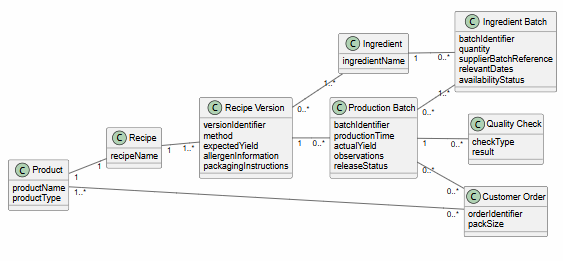

**Kerry Kitchen Collective** is a small batch production service producing preserves, sauces, baked goods and seasonal products for shops, markets and direct customers. The current process relies on spreadsheets and paper records to manage recipe, ingredients, production batch, orders and label.
The proposed system focused on improving recipe version control, ingredient and batch tracking, production planning, quality and release control, traceability between ingredient batches, production batches and customer orders.

### Scope. 
The scenario has a clear business boundary. 
In scope: recipe versions, ingredients, production planning, production batches, quality checks, order allocation and traceability.
Out scope: equipment control, retail payments, full financial accounting.
### Behaviour.
The scenario contains workflow and business rules:
- batches may be delayed, resized or split;
- substitutions require review;
- quality checks affect release status;
- actual yield may differ from expected yield.
### OO potential
The domain contains interacting concepts such as Product, Recipe, Recipe Version, Ingredient, Ingredient Batch, Production Batch, Customer Order, Quality Check. These concepts have meaningful relationships and provide opportunities for assigning responsibilities and collaborations.
### Sliceability
The system can be divided into functional areas such as recipe management, ingredients management, production planning, batch recording, quality control, traceability.
### Testability
Important behaviour can be expressed through observable scenarios and rules, such as recording a batch, recording a substitution, preventing release before required quality checks, and tracing affected customer orders.
### Comparability
The scenario provides enough analysis and behavioural material to compare alternative design decisions.
 
 ---

The conceptual **domain model** identifies the main business concepts within the proposed system and the relationships between them. It provides an overview of the domain structure and helps demonstrate the scenario`s potential for further object – oriented design.

