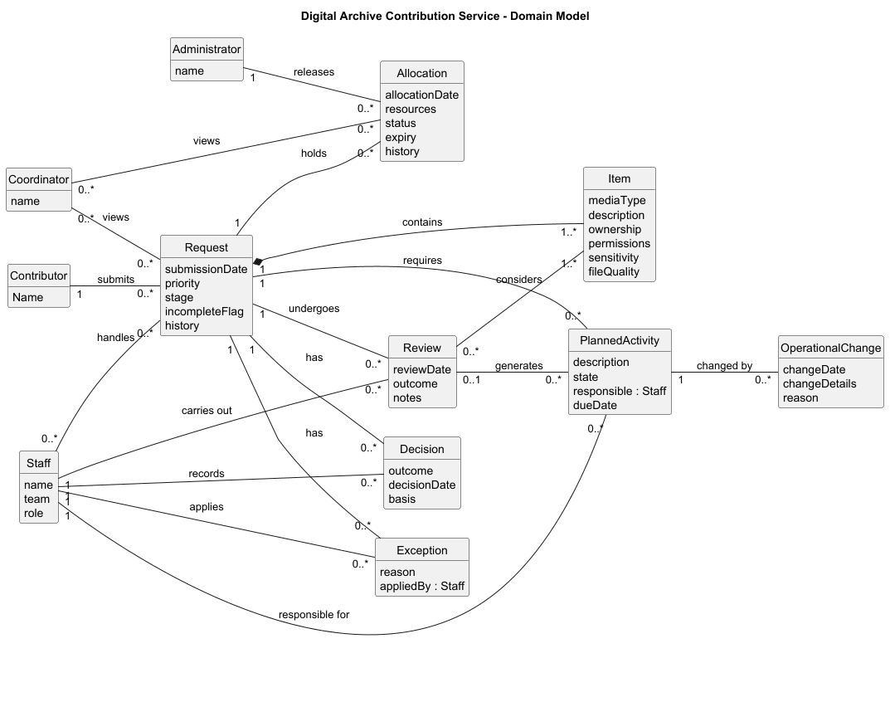

# Scenario
## 30 - Digital Archive Contribution Service -
https://github.com/Ahmad-1031/OOAD_CA1

## Description:
Kerry Community Digital Archive is a Digital Archive Contribution Service which receives photographs, documents, audio and video contributed by individuals and local organisations. The current system stores submission files, descriptions, ownership statements, permissions, review notes and publication decisions across forms, folders and spreadsheets

The proposed Digital Archive Contribution Service provides staff, contributors, managers, coordinators to handle contributions more effectively. The proposed system allows contributors to submit a contribution, view rights and permissions of files and track progress. Staff can handle requests with information about a contribution stored in its history, apply correct priority and generate reviews. The proposed system allows managers and coordinators to manage allocations, releasing stalled requests and freeing up capacity

## Scope 

The system has a clear system boundary scope and is focused towards the archive service users. 

**In Scope:**

**Contributors** can submit a request, views rights and permissions. **Staff** can apply priorities and exceptions, record records offline, preserve archive item, set activity status, review and send partner information, view contribution record, record request authority. **Coordinators** can view coordination overview, **Administrator** can release stalled allocations and **Reviewer** can manage linked arrangements.

**Out Scope:** 

The proposed system does not support specialist professional systems, financial accounting and unrelated public website functions

## Behaviour
The scenario contains clear workflows and business rules

- Earlier evidence and versions must be kept for each submission
- A request must not be allocated unless it fulfils every readiness criteria
- Requests can have different states; paused, withdrawn, partially complete, awaiting action
- Requests undergo review and reviews can generate new planned activity

## OO Potential
The domain contains several interacting concepts with clear responsibilities. A contributor submits a request. A request can have decisions, reviews and exceptions, and a review can generate planned activity. Requests have an allocation, and operational changes record changes to that work. Requests also have items.

## Sliceability 

The system can be divided into vertical slices. Each starts from a system event and ends in an observable outcome:

- **Submit Contribution** - a contributor submits a contribution and views its rights and permissions. **Outcome:** a stored request and rights view
- **Allocate request** - a request is allocated only if it meets every readiness criterion. **Outcome:** allocation accepted, or rejected with a reason
- **Process request** - staff set priority, record a review, make decisions and exceptions. **Outcome:** updated priority and request history
- **Release stalled allocations** - an administrator releases stalled allocations to free capacity. **Outcome:** capacity updated and the request returned for reallocation

## Testability
Each slice can be tested against rules it applies. The rules have observable outcomes, such as rejected allocation or an updated request history, and can be checked with fixed fixtures and test doubles in place of unavailable dependencies

## Comparability
The scenario has clear actors, use cases, candidate classes, allowing it be used to directly compare with other scenario profiles 

The conceptual domain model shows how the main concepts carry the business rules, giving foundation for further object-orientated design.

