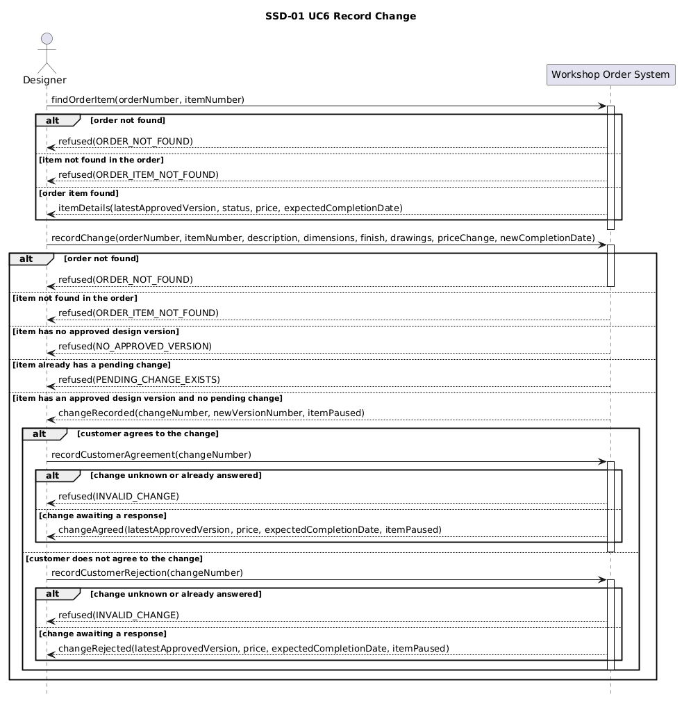

# 05 - System Sequence Diagrams

## SSD-01: UC6 Record Change

SSD-01 shows the events the designer sends to the workshop order system when recording a change to an approved design, and what the system returns. The system is treated as a black box. Internal checks, records and links are left to the operation contracts and object-interaction diagrams.

Source: [ssd-uc6-record-change.puml](../../ssd-uc6-record-change.puml)

### Scenario and actor

| Element       | Description                                                                                        |
| ------------- | -------------------------------------------------------------------------------------------------- |
| Identifier    | SSD-01                                                                                             |
| Use case      | UC6 Record Change                                                                                  |
| Scenario      | Main success scenario, with the customer's agreement or rejection as alternatives                  |
| Primary actor | Designer                                                                                           |
| Offstage      | Customer. The customer responds to the designer outside the system and never sends a system event. |

### What SSD-01 establishes

- The primary actor is the designer.
- The first operation that changes anything is recordChange(...), after a findOrderItem(...) query.
- The parameters crossing the boundary are listed on each event.
- A change can only be recorded against an item with an approved design version. Otherwise it is refused with NO_APPROVED_VERSION and nothing is recorded.
- recordChange returns a changeNumber, and the customer's agreement or rejection is recorded against that number. An order item can have more than one change, so the order and item numbers alone do not identify which change the customer is answering.
- A response to a change that is unknown or already answered is refused with INVALID_CHANGE and nothing is modified.
- Each reply shows whether the item is paused, so the pause and its release can be checked.

### Use case steps to system events

| UC6 step                                                     | Actor action or internal | In SSD-01 as                               |
| ------------------------------------------------------------ | ------------------------ | ------------------------------------------ |
| 1. The designer identifies the item and describes the change | Actor action             | findOrderItem(...)                         |
| 2. The system shows the current approved version and stage   | System response          | itemDetails(...)                           |
| 3. The designer creates a new design version                 | Actor action             | Part of recordChange(...)                  |
| 4. The designer records the effect on price and date         | Actor action             | Part of recordChange(...)                  |
| 5. The system links the change to both versions              | Internal                 | Not shown                                  |
| 6. The system pauses affected work                           | Internal                 | Shown as itemPaused in changeRecorded(...) |
| 7. The designer records that the customer agreed             | Actor action             | recordCustomerAgreement(changeNumber)      |
| 8. The system updates the approved version, price and date   | Internal                 | Shown in the changeAgreed(...) response    |

Steps 3 and 4 are one event, as the change and its new design version are recorded together.
