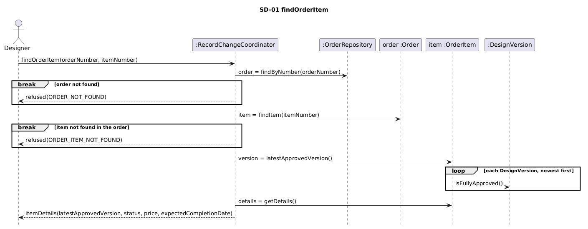
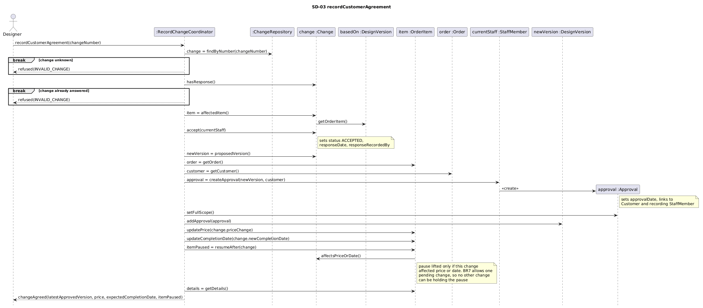

# 10 - Object Interaction Diagrams

## Object interaction for UC6 Record Change

The object interaction diagrams show how the design classes carry out each system operation in SSD-01. Each diagram starts with the same system event as the SSD and only uses methods from the Design Class Diagram.

Source: [sd-uc6-record-change.puml](../../sd-uc6-record-change.puml)

### SD-01: findOrderItem

| Contract | Gherkin |
| --- | --- |
| OC-01 | GH13 |

- The coordinator finds the order through OrderRepository and the item through Order.
- OrderItem finds its latest approved version by asking each DesignVersion if it is fully approved.

### SD-02: recordChange

| Contract | Gherkin |
| --- | --- |
| OC-02 | GH3, GH7, GH8, GH9, GH10, GH11 |

- All four refusals are checked before anything is created.
- ChangeRepository gives the next changeNumber, as it knows every Change (OQ-01).
- StaffMember creates the Change (CR-01) and the Change creates the new DesignVersion (CR-02).
- OrderItem asks the Change if it affects the price or date, and only pauses if it does (OQ-06). pauseIfAffected returns whether the item is paused, which goes into changeRecorded.

### SD-03: recordCustomerAgreement

| Contract | Gherkin |
| --- | --- |
| OC-03 | GH6, GH12 |

- The Change records the response and who recorded it (OQ-05).
- StaffMember creates the Approval (CR-03) and the scope is set to Full (OQ-02).
- OrderItem updates its own price and completion date, then resumeAfter lifts the pause if this change caused it. resumeAfter returns whether the item is still paused, which goes into changeAgreed.

### SD-04: recordCustomerRejection

| Contract | Gherkin |
| --- | --- |
| OC-04 | GH4, GH14 |

- The Change records the rejection and who recorded it (OQ-05).
- No Approval is created and the price and date are not changed.
- resumeAfter lifts the pause if this change caused it and returns whether the item is still paused, which goes into changeRejected.

### DCD methods added while drawing

| Class | Method | Reason |
| --- | --- | --- |
| OrderItem | getDetails() : ItemDetails | Return item details to the coordinator (CRC: Provide current OrderItem details) |
| OrderItem | getOrder() : Order | Reach the Customer for the Approval |
| Order | getCustomer() : Customer | Reach the Customer for the Approval |
| Change | proposedVersion() : DesignVersion | Approve the version the Change created |
| ChangeRepository | nextChangeNumber() : int | Give each Change a unique changeNumber (OQ-01) |
| StaffMember | createChange gains a changeNumber parameter | Pass the number to the new Change |
| OrderItem | pauseIfAffected and resumeAfter return boolean | Give itemPaused for changeRecorded, changeAgreed and changeRejected |
| Refusal, RefusalCode | New class and enum, held as an optional refusal in each result type | Return refusal outcomes through the existing return types |
| Change | newCompletionDate becomes optional [0..1] | Left empty when the date is not moved, so affectsPriceOrDate() reads only the Change |

### Consistency check

- [x] The first message of each diagram matches SSD-01
- [x] Every message is a method on the receiving class in the DCD
- [x] Every lifeline is a class in the DCD
- [x] Every postcondition in OC-01 to OC-04 is carried out
- [x] Refusals happen before any object is created or changed
- [x] Creators follow DR-06 (CR-01 to CR-03)

### Design notes

- **Pause and resume.** isPaused is only set by pauseIfAffected, and only when the Change affects price or date (OQ-06). BR7 allows one pending change per item, so when a response is recorded, that Change is the only one that can be holding the pause. resumeAfter asks the Change affectsPriceOrDate() and lifts the pause if it did. Pauses from outside UC6 are out of scope.
- **itemPaused in responses.** ItemDetails matches itemDetails(...) in SSD-01 and does not hold the pause. pauseIfAffected and resumeAfter return the pause state, and the coordinator puts it in ChangeResult and ResponseResult.
- **Refusals.** ItemDetails, ChangeResult and ResponseResult each hold an optional Refusal. On success it is empty. When a check fails, the coordinator returns the result with the Refusal and its RefusalCode set, and nothing is created or changed.
- **Price or date impact.** affectsPriceOrDate() reads only the Change's own priceChange and newCompletionDate, which is left empty if the date is not moved. The answer does not change after OrderItem's price and date are updated in SD-03.
