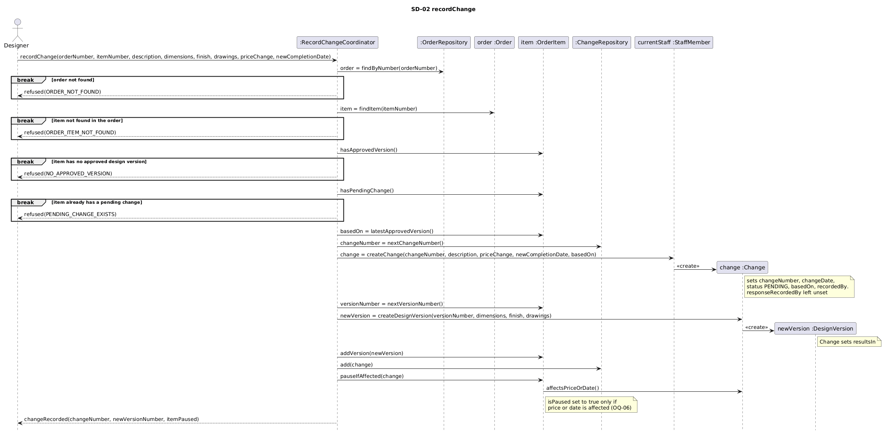
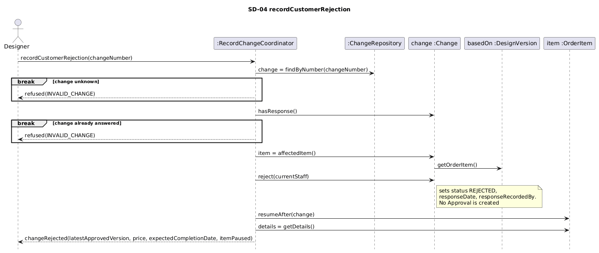

# 10 - Object Interaction Diagrams

## Object interaction for UC6 Record Change

The object interaction diagrams show how the design classes carry out each system operation in SSD-01. Each diagram starts with the same system event as the SSD and only uses methods from the Design Class Diagram.

Source: [sd-uc6-record-change.puml](../../sd-uc6-record-change.puml)

### SD-01: findOrderItem

| Contract | Gherkin |
| --- | --- |
| OC-01 | GH9, GH10 |

- The coordinator finds the order through OrderRepository and the item through Order.
- OrderItem finds its latest approved version by asking each DesignVersion if it is fully approved.

### SD-02: recordChange

| Contract | Gherkin |
| --- | --- |
| OC-02 | GH3, GH7, GH8, GH9, GH10, GH11 |

- All four refusals are checked before anything is created.
- ChangeRepository gives the next changeNumber, as it knows every Change (OQ-01).
- StaffMember creates the Change (CR-01) and the Change creates the new DesignVersion (CR-02).
- OrderItem asks the Change if it affects the price or date, and only pauses if it does (OQ-06).

### SD-03: recordCustomerAgreement

| Contract | Gherkin |
| --- | --- |
| OC-03 | GH6, GH12 |

- The Change records the response and who recorded it (OQ-05).
- StaffMember creates the Approval (CR-03) and the scope is set to Full (OQ-02).
- OrderItem updates its own price and completion date, then lifts the pause.

### SD-04: recordCustomerRejection

| Contract | Gherkin |
| --- | --- |
| OC-04 | GH4, GH12 |

- The Change records the rejection and who recorded it (OQ-05).
- No Approval is created and the price and date are not changed.

### DCD methods added while drawing

| Class | Method | Reason |
| --- | --- | --- |
| OrderItem | getDetails() : ItemDetails | Return item details to the coordinator (CRC: Provide current OrderItem details) |
| OrderItem | getOrder() : Order | Reach the Customer for the Approval |
| Order | getCustomer() : Customer | Reach the Customer for the Approval |
| Change | proposedVersion() : DesignVersion | Approve the version the Change created |
| ChangeRepository | nextChangeNumber() : int | Give each Change a unique changeNumber (OQ-01) |
| StaffMember | createChange gains a changeNumber parameter | Pass the number to the new Change |

getOrder, getCustomer and nextChangeNumber are not yet in CRC-06.

### Consistency check

- [x] The first message of each diagram matches SSD-01
- [x] Every message is a method on the receiving class in the DCD
- [x] Every lifeline is a class in the DCD
- [x] Every postcondition in OC-01 to OC-04 is carried out
- [x] Refusals happen before any object is created or changed
- [x] Creators follow DR-06 (CR-01 to CR-03)

### Open questions

- How resumeAfter knows whether this Change caused the pause and whether other blocking conditions remain. isPaused alone does not record the reason (see the open design note in 07).
