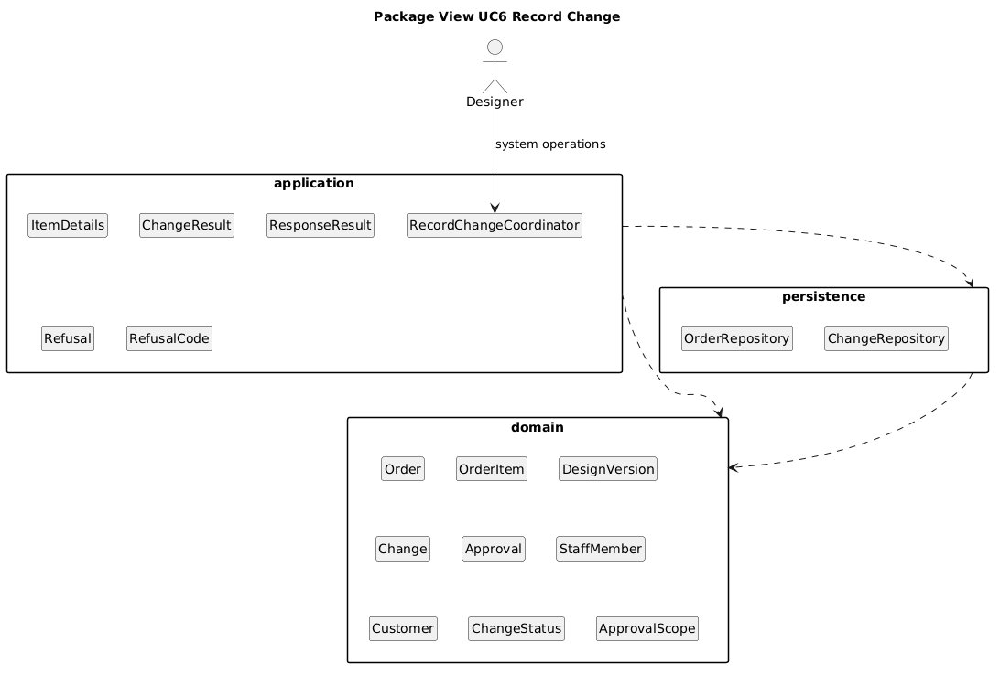

# 11 - Design Structure and Shared Interfaces

## Package view for UC6 Record Change

The design is split into three packages. Dependencies only point from application to domain and persistence, and from persistence to domain. Domain classes do not depend on the coordinator or the repositories.

Source: [package-uc6-record-change.puml](../../package-uc6-record-change.puml)

| Package | Classes | Responsibility | Depends on |
| --- | --- | --- | --- |
| application | RecordChangeCoordinator, ItemDetails, ChangeResult, ResponseResult, Refusal, RefusalCode | Receives the system operations from SSD-01, runs the checks, coordinates the domain objects and returns results | domain, persistence |
| domain | Order, OrderItem, DesignVersion, Change, Approval, StaffMember, Customer, ChangeStatus, ApprovalScope | Holds the business state and rules: versions, approvals, changes, pause | Nothing outside domain |
| persistence | OrderRepository, ChangeRepository | Finds and stores Orders and Changes | domain |

## System interface

RecordChangeCoordinator is the only entry point for the designer (CT-01). Each operation matches one system event in SSD-01 and one operation contract.

| Operation | Input | Returns | Contract | Diagram |
| --- | --- | --- | --- | --- |
| findOrderItem | orderNumber, itemNumber | ItemDetails | OC-01 | SD-01 |
| recordChange | orderNumber, itemNumber, description, dimensions, finish, drawings, priceChange, newCompletionDate [0..1] | ChangeResult | OC-02 | SD-02 |
| recordCustomerAgreement | changeNumber | ResponseResult | OC-03 | SD-03 |
| recordCustomerRejection | changeNumber | ResponseResult | OC-04 | SD-04 |

## Result types

| Type | Fields | Returned by |
| --- | --- | --- |
| ItemDetails | latestApprovedVersion, status, price, expectedCompletionDate, refusal [0..1] | findOrderItem |
| ChangeResult | changeNumber, newVersionNumber, itemPaused, refusal [0..1] | recordChange |
| ResponseResult | latestApprovedVersion, price, expectedCompletionDate, itemPaused, refusal [0..1] | recordCustomerAgreement, recordCustomerRejection |

The fields match the returns in SSD-01, with refusal added for the error convention below.

## Persistence boundary

| Class | Operations | Used by |
| --- | --- | --- |
| OrderRepository | findByNumber(orderNumber) : Order | findOrderItem, recordChange |
| ChangeRepository | findByNumber(changeNumber) : Change, add(change), nextChangeNumber() : int | recordChange, recordCustomerAgreement, recordCustomerRejection |

Both are Pure Fabrications (PF-01, PF-02). They keep storage and lookup out of the domain classes, so the domain can be tested with in-memory repositories.

## Error convention

- Every refusal is returned in the operation's own result type, with refusal set and the other fields empty. On success, refusal is empty.
- All checks run before any object is created or changed, so a refusal leaves the system unchanged.
- Each refusal has one RefusalCode. The same code is used in the SSD, contracts, sequence diagrams and Gherkin.

| RefusalCode | When | Operations | Gherkin |
| --- | --- | --- | --- |
| ORDER_NOT_FOUND | The order number does not exist | findOrderItem, recordChange | GH9 |
| ORDER_ITEM_NOT_FOUND | The item is not in the order | findOrderItem, recordChange | GH10 |
| NO_APPROVED_VERSION | The item has no fully approved design version | recordChange | GH11 |
| PENDING_CHANGE_EXISTS | The item already has a change waiting for a response (BR7) | recordChange | GH8 |
| INVALID_CHANGE | The change number is unknown or the change has already been answered | recordCustomerAgreement, recordCustomerRejection | GH12, GH14 |

## Rejected alternatives

| Alternative | Why it was rejected |
| --- | --- |
| Throw an exception for each refusal | Refusals are expected outcomes in the use case, not errors. Returning them in the result type matches refused(CODE) in SSD-01 and the sequence diagrams. |
| A separate Refusal return type for each operation | Each operation would need two return types, so the signatures would no longer show one result per system event. |
| Domain classes look up Orders and Changes themselves | Couples the domain to storage and makes it harder to test (PF-01, PF-02). |
